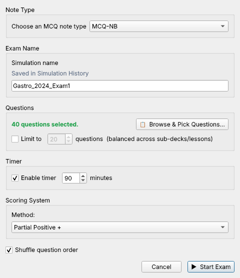
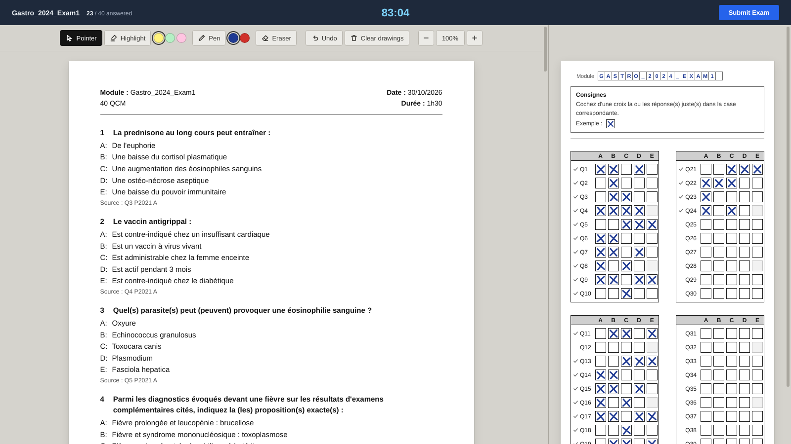
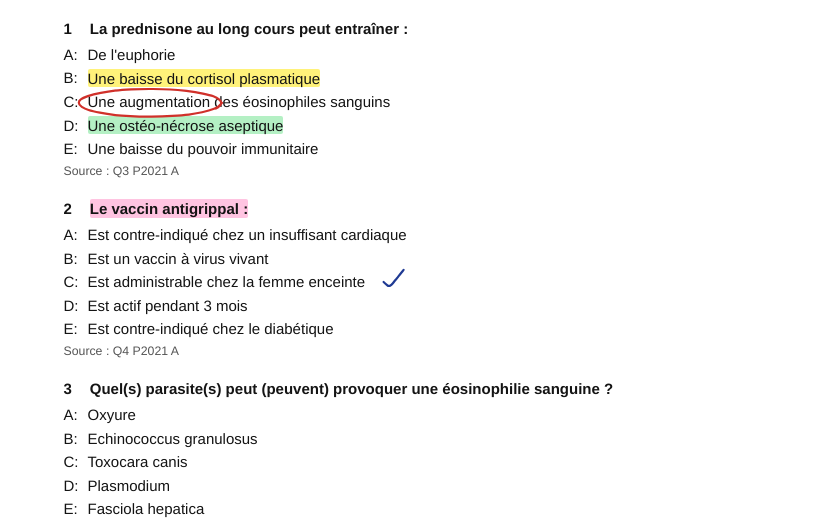
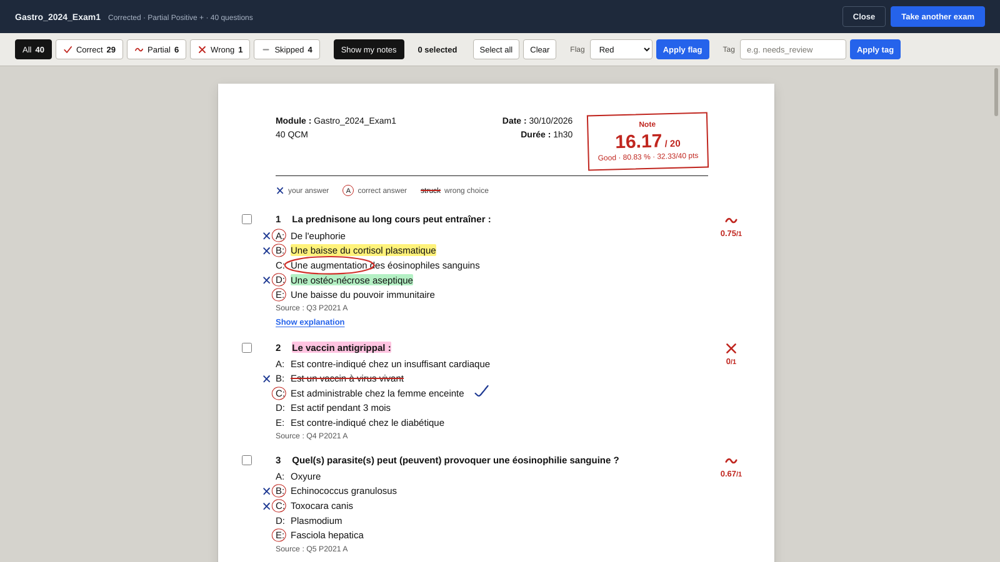

# Exam Simulator - NB

An Anki add-on that turns your MCQ note bank into a proper exam-style simulation workflow.

Instead of reviewing questions one by one in normal Anki mode, you can build custom exams, filter your question pool, apply timing and scoring rules, and sit the exam on a screen that looks like the real paper: a printed question booklet with a separate answer sheet you mark with a cross. Afterwards you get your booklet back, corrected in red pen.

## Why this exists

Anki is excellent for recall. It is not, by default, an exam simulator.

If your note bank is built around MCQs, sometimes you do not want spaced repetition mode — you want to sit a paper, answer under constraints, then review mistakes like an actual exam.

That is what this add-on is for.

## What it does

Exam Simulator - NB lets you:

- build custom exams from your Anki MCQ notes
- filter questions by deck, tags, simulation history, and flags
- choose a fixed question count
- run timed or untimed sessions
- shuffle question order
- apply different scoring systems
- highlight and write on the question booklet while you sit the exam
- review a corrected copy of your booklet, question by question
- flag or tag selected questions after the exam
- keep simulation history locally without polluting normal Anki tags

## Screenshots

### Exam Setup


### The Exam: Question Booklet and Answer Sheet


### Highlighter and Pen


### Results: the Corrected Booklet


## Main Features

### Exam Builder
- choose the MCQ note type
- browse and select questions manually
- set the number of questions
- give the exam a name
- optionally shuffle question order

### Flexible Filtering
You can narrow the question pool using:
- Decks
- Tags
- Simulation History
- Flags

### Balanced Sampling
The add-on supports balanced round-robin style sampling across subdecks so a single deck does not dominate the exam unnecessarily.

### Exam Interface
- **Question booklet:** a printed-page layout in the style of a faculty MCQ paper (Module, Date, Durée header; numbered questions; `A:` options).
- **Separate answer sheet:** blocks of 10 rows in two columns, like the real answer sheet. Click a box to mark it with a pen cross; click again to remove it. A small tick appears beside each question you have answered.
- The booklet and the answer sheet scroll independently, so the sheet stays in view while you read.
- Click a question number on the sheet to jump to that question in the booklet.
- Timer, with a warning in the last 5 minutes and automatic submission when time runs out.

### Highlighter, Pen and Zoom
- **Highlighter** in yellow, green or pink: drag over text. Click a highlight to remove it.
- **Pen** in blue or red: write or draw directly on the booklet.
- **Eraser**, **Undo** and **Clear drawings**.
- **Zoom** magnifies the whole page (70–200%) without re-flowing the text, so your marks stay on the right words. The answer sheet grows with it.
- Your highlights and drawings last for the whole exam. A new exam starts clean.

| Key | Action |
|---|---|
| `H` | Highlighter |
| `P` | Pen |
| `E` | Eraser |
| `Esc` | Back to the pointer |
| `Ctrl` + `Z` | Undo |
| `Ctrl` + `+` / `Ctrl` + `−` | Zoom in / out |
| `Ctrl` + `0` | Reset zoom |

### Scoring Modes
- **All or Nothing**
- **Partial Positive +**
- **Partial Negative -**

### Results Review
After submission you get your booklet back, corrected:
- your mark out of 20, percentage and points in a red **Note** box
- your crosses in the margin, the correct answers circled in red, and wrong choices struck through
- a red-pen mark and score beside every question: ✓ correct, ~ partial, ✗ wrong, — skipped
- your highlights and drawings in the same places, with a **Show my notes** switch to hide them
- filters for correct / partial / wrong / skipped
- optional explanation reveal
- bulk flagging and tagging for selected questions
- quick launch for another exam

### Local Simulation History
Named exams are stored locally by the add-on and can be reused later as a filter source.

You can:
- reuse prior simulations
- delete selected history items
- clear all history

This history is add-on-owned and local. It does **not** rely on normal Anki tags for storage.

## Expected Note Type

By default, the add-on is built around a note type named:

- `MCQ-NB`

It expects these fields:

- `Question`
- `option_1 (A)`
- `option_2 (B)`
- `option_3 (C)`
- `option_4 (D)`
- `option_5 (E)` *(optional if unused)*
- `Ans`
- `Source` *(optional)*
- `Explanation` *(optional)*

## Answer Format

The `Ans` field can use either letters or numbers.

Examples:
- `A`
- `B`
- `AC`
- `1`
- `13`

Mapping:
- `1 -> A`
- `2 -> B`
- `3 -> C`
- `4 -> D`
- `5 -> E`

## How it works

1. Open Anki
2. Go to **Tools → Exam Simulator - NB**
3. Choose the relevant MCQ note type
4. Filter or browse the questions you want
5. Set the number of questions
6. Name the exam if you want it saved in Simulation History
7. Choose timing and scoring options
8. Start the exam and mark your answers on the answer sheet
9. Submit and review the corrected booklet

## Scoring Modes

### All or Nothing
A question only scores if the full answer is correct.

### Partial Positive +
Correct selections earn credit. Wrong selections reduce that partial credit, but the final score for the question does not go below zero.

### Partial Negative -
Correct selections earn credit. Wrong selections subtract credit and may push the raw question score below zero before the final exam total is normalized.

## Simulation History

Named simulations are stored in a local add-on file:

- `exam_simulator_history.json`

This file lives inside the current Anki profile folder.

Important:
- it is **local only**
- it does **not** create normal Anki tags
- deleting simulation history does **not** delete notes
- starting an unnamed exam does **not** save it in history

## Results Workflow

After an exam, you can:

- review each question on the corrected booklet
- show or hide your highlights and drawings
- reveal explanations
- filter results by status
- select specific questions
- bulk tag selected questions
- bulk flag selected questions
- start another exam immediately

## Privacy and Storage

This add-on stores simulation history locally in your Anki profile.

It does not require a server, account, or external backend.

## Known Limitations

- currently designed around a specific MCQ field structure
- best suited for note types that follow the expected field names
- not intended to be a universal quiz engine for arbitrary note schemas
- answer choice order is not currently randomized
- text printed on the exam paper is in French (Module, Date, Durée, Consignes); buttons and menus are in English
- highlights and drawings are not saved after you close the results window

## Roadmap

Potential future improvements:

- configurable field mapping from the UI
- support for more note schemas
- exportable exam reports
- richer analytics
- exam presets
- answer choice randomization

## Tests

The `tests/` folder runs the add-on against a real Anki collection and opens the real exam window (hidden). It covers scoring, note parsing, sampling, history, the setup and picker windows, the exam paper and its tools, and the results page.

```sh
python -m venv .venv && .venv/bin/pip install -r tests/requirements.txt
.venv/bin/python -m pytest -c tests/pytest.ini tests
```

See [tests/README.md](tests/README.md) for details.

## License

MIT License.
